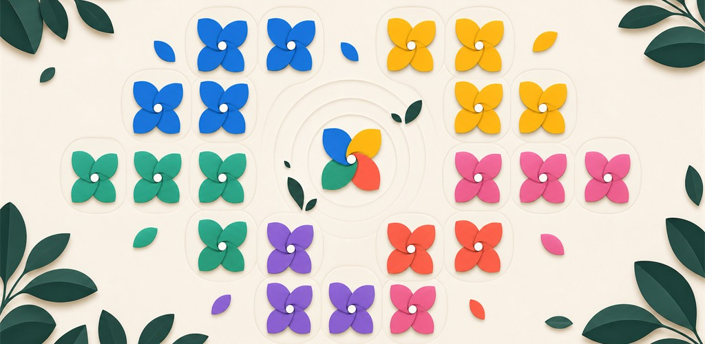
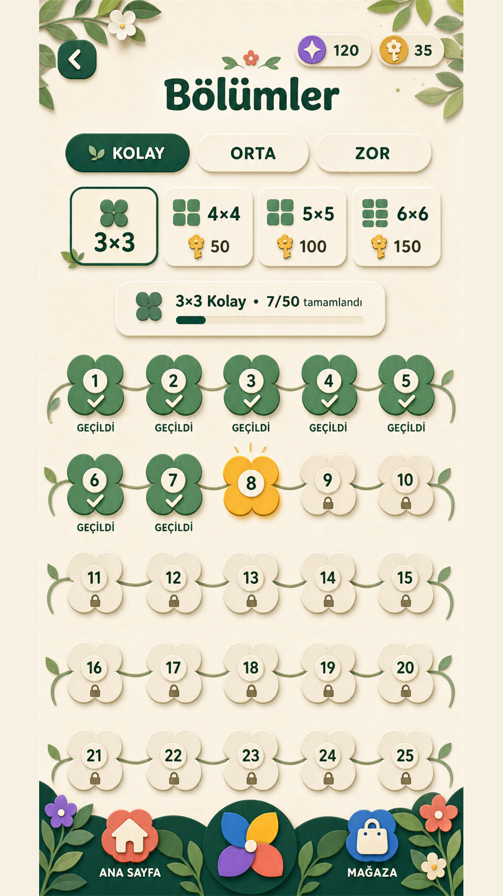
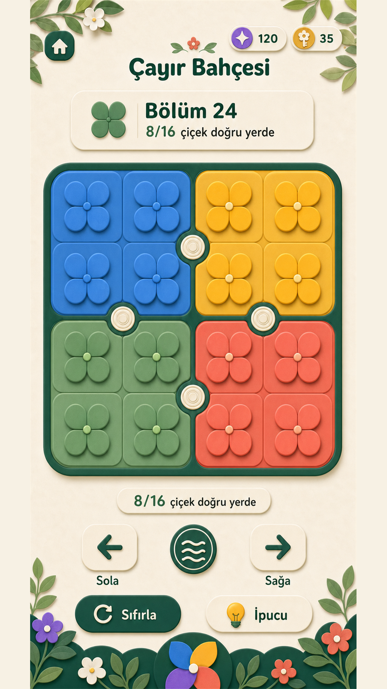
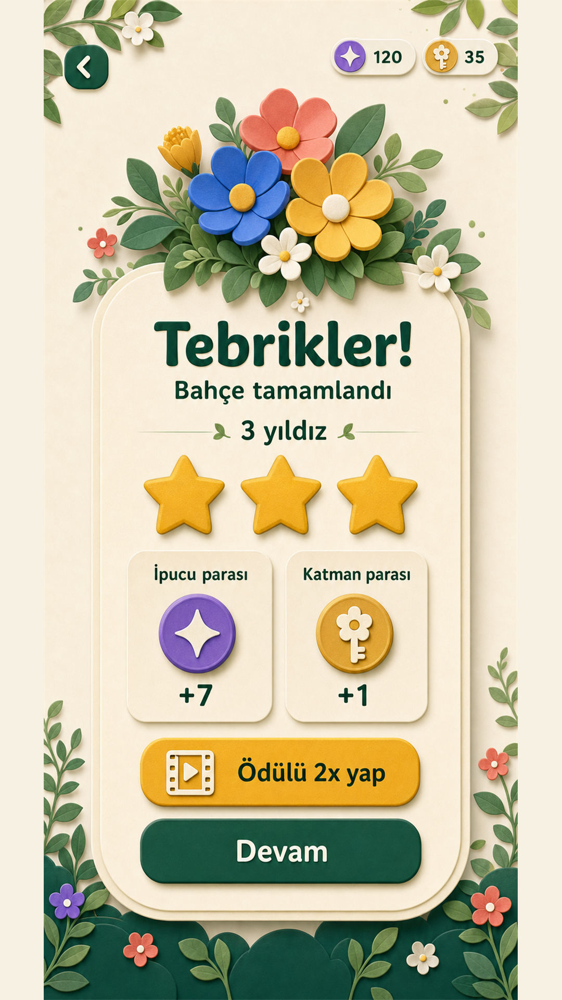
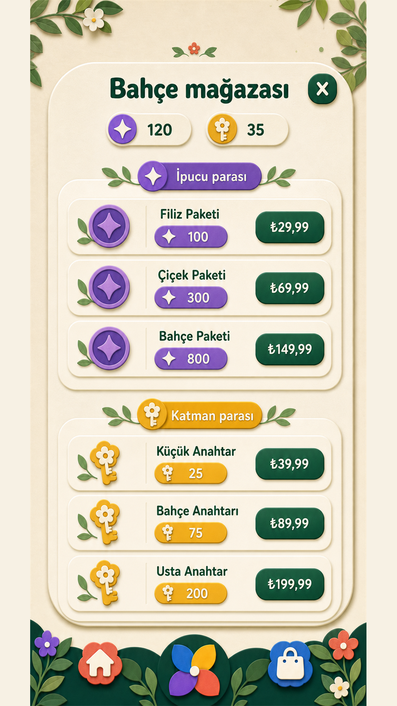

<p align="center">
  
</p>

<h1 align="center">Bloomshift</h1>

<p align="center">
  A production-ready mobile color puzzle built with React Native and Expo.
</p>

<p align="center">
  <a href="https://apps.apple.com/us/app/bloomshift/id6800653408">App Store</a>
  ·
  <a href="https://play.google.com/store/apps/details?id=com.gorsengames.dalgabahcesi">Google Play</a>
  ·
  <a href="https://gorsengames.com">Görsen Games</a>
</p>



## About

Bloomshift is a relaxing spatial puzzle in which players rotate groups of four
flowers and guide every flower onto a garden cell of the matching color. One
input changes four positions at once, turning a simple interaction into a
planning-focused puzzle that scales from compact 2×3 boards to 6×6 gardens.

The game is published on both iOS and Android and includes more than 900
deterministically generated, solvable levels across Easy, Medium, and Hard
difficulty modes.

## Screenshots

<p align="center">
  
  
  
  
</p>

## Product highlights

- More than 900 solvable puzzles with 2×3, 3×3, 4×3, 4×4, 5×4, 5×5, 6×5,
  and 6×6 board layouts
- Progressive Easy, Medium, and Hard modes with increasingly mixed targets
- Smooth flower movement, rotation feedback, haptics, sound, and music
- Interactive onboarding and a three-level warm-up sequence
- Hint, reset, star rating, rewards, unlockable gardens, and local progression
- English and Turkish localization
- Responsive layouts for phones and tablets with safe-area support
- Rewarded and interstitial advertising with an optional remove-ads purchase
- Consumable coin packs and restorable non-consumable purchases
- Published App Store and Google Play release workflows

## Engineering highlights

- Seeded procedural level generation produces repeatable puzzles while avoiding
  duplicate starting boards within a progression group.
- Every board begins from a solved target and is scrambled through legal moves,
  guaranteeing a valid solution path.
- Transaction IDs are persisted to prevent duplicate in-app purchase rewards.
- Progress, settings, language, currencies, results, and entitlements are stored
  locally with schema-aware migration.
- Native advertising and in-app purchase modules degrade safely during
  development when their native runtime is unavailable.
- Platform-specific App Store and Google Play identifiers share one gameplay
  codebase without changing the puzzle rules.

## Tech stack

| Area | Technology |
| --- | --- |
| Application | React Native 0.81, React 19, TypeScript |
| Tooling | Expo SDK 54, EAS Build and Submit |
| Persistence | AsyncStorage |
| Media | Expo Audio, Expo Asset, Expo Haptics |
| Monetization | Google Mobile Ads, Expo IAP / StoreKit / Play Billing |
| Platforms | iOS, iPadOS, Android |

## Project structure

```text
.
├── App.tsx                 # Screens, interactions, animation and app flow
├── src/
│   ├── game.ts             # Board rules and deterministic level generation
│   └── progress.ts         # Persistence, rewards and save migration
├── assets/                 # Production artwork, audio and branding
├── android/                # Android native configuration
├── docs/screenshots/       # Portfolio and store screenshots
├── scripts/                # Asset and audio preparation utilities
├── app.json                # Expo, iOS and Android configuration
└── eas.json                # Preview and production build profiles
```

## Local development

Requirements: Node.js, npm, Android Studio for Android native builds, and macOS
with Xcode for local iOS native builds.

```bash
npm install
npm run typecheck
npm run android
```

Because the project uses native advertising and in-app purchase modules, full
store functionality requires a development build, TestFlight build, or Google
Play test build. Expo Go can be used only for limited UI/gameplay checks.

Production builds are created with:

```bash
npm run build:production
npm run build:ios:production
```

## Privacy and ownership

Bloomshift does not require an account. Game progress is stored locally on the
device. Advertising and store transactions are handled by the relevant
platform providers; see [PRIVACY_POLICY.md](PRIVACY_POLICY.md) for details.

This source repository is shared for portfolio and review purposes. It is not
open source. All original Bloomshift code, design, artwork, audio, level data,
and branding are © 2026 Görsen Games. See [LICENSE](LICENSE).
